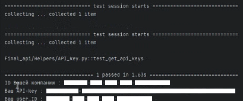

# Diplom
# Дипломный проект: Автоматизация тестирования сайта YouGile API и UI
Описание проекта
Проект по автоматизации тестирования социальной сети VK с использованием:
Python — язык программирования;
PyTest — фреймворк для тестирования;
Selenium WebDriver — для UI‑тестов;
Requests — для API‑тестов;
Allure — для отчётов.
Требования
Python 3.14+;
Google Chrome (последняя версия);
Git.
Ссылка на финальный проект
GitHub репозиторий:
Ссылка : https://github.com/slon7672/Diplom
Ветка с дипломным проектом: main
## Установка и настройка
* Клонирование репозитория
   ```bash
   git clone <URL-репозитория>
   cd Diplom.
   
* Создание виртуального окружения
   ```bash
  python -m venv venv

### Активация виртуального окружения
* Windows:
   ```bash
   venv\Scripts\activate

* Установка зависимостей
   ```bash
   pip install -r requirements.txt

* Рекомендуемые 
  - allure-pytest>=2.16.1
  - allure-python-commons>=2.16.1
  - flake8>=7.4.1
  - pytest>=9.1.1
  - pytest-html>=4.2.0
  - pytest-repeat==0.9.4
  - python-dotenv==1.2.3
  - requests>=2.34.2
  - selenium==4.49.0
  - webdriver-manager==4.1.2


# Структура проекта

    Diplom/
    ├── allure-report/          # Сгенерированный HTML отчет Allure
    ├── allure-results/         # Сырые данные для отчета Allure
    ├── Helpers/
    │   └── Allure_helper.py    # Вспомогательные функции для Allure
    ├── Pages/
    │   ├── __init__.py
    │   ├── UI_YGP.py           # Page Object для UI тестов
    │   └── API_YGP.py          # Page Object для API тестов
    ├── screenshots/            # Папка для скриншотов
    ├── tests/
    │   ├── __init__.py
    │   ├── test_api-yg.py      # API тесты
    │   └── test_ui_yg.py       # UI тесты
    ├── .env                    # Переменные окружения (секреты)
    ├── .gitignore              # Исключения для Git
    ├── conftest.py             # Фикстуры Pytest
    ├── pytest.ini              # Конфигурация Pytest
    ├── README.md               # Описание проекта
    └── requirements.txt        # Зависимости проекта

# Что автоматизировано
## API‑тесты (11 тестов):
    test_get_id_company                        # запрос id компании
    test_get_id_company_negative_aut           # запрос id компании с некорректными данными пользователя (негативный)
    test_create_new_project                    # создание нового проекта
    test_create_duble_project_negative         # создание дубля проекта (негативный)
    test_create_new_project_negative_user_id   # создание нового проекта с невалидным id пользователя (негативный)
    test_rename_project                        # переименование проекта
    test_rename_project_negative_id_key        # переименование проекта с невалидным api-ключом (негативный) 
    test_get_project_on_id                     # запрос проекта по id 
    test_delete_project_id                     # удаление проекта по id 
    test_delete_on_project_id_negative         # удаление проекта по некорректному id (негативный)
    test_get_all_projects                      # запрос списка проектов

## UI‑тесты (0 тестов):
          


# Настройка переменных окружения
**Перед запуском заполните необходимые значения:**  
  - Скопируйте .env.example в .env
  - LOG - подставьте свой e-mail, используемый для регистрации на сайте
  - PASS - подставьте свой пароль
  - Поиск API_KEY, USER и ID_COMPANI:
   
    - Откройте папку Helpers
    - Откройте файл **get_api_key.py**
    - Раскомментируйте код
    - Вручную запустите тест **test_get_api_keys** 
    - Полученные в консоли значения перенесите в .env в соответствующие строки переменных API_KEY, USER и ID_COMPANI
    - Верните код в исходное состояние (закомментируйте)
Пример:


# Команды для запуска тестов
* Все тесты (UI + API)
    ```bash
    pytest -v

* Запуск с Allure‑отчётом
    ```bash
    pytest --alluredir=allure-results -v
    allure serve allure-results

* Запуск конкретного тестового файла
    ```bash
    pytest Tests/test_api.py -v
    pytest Tests/test_ui.py -v

* Запуск конкретного теста по имени
    ```bash
    pytest -k "test_get_id_company" -v

* Только позитивные сценарии
    ```bash
    pytest -m positive

* Только негативные сценарии
    ```bash
    pytest -m negative

## Результаты выполнения тестов

### API‑тесты

 - `tests/test_api_yg.py::test_get_id_company` — **PASSED**
 - `tests/test_api_yg.py::test_get_id_company_negative_aut` — **PASSED**
 - `tests/test_api_yg.py::test_create_new_project` — **PASSED**
 - `tests/test_api_yg.py::test_create_duble_project_negative` — **PASSED**
 - `tests/test_api_yg.py::test_create_new_project_negative_user_id` — **PASSED**
 - `tests/test_api_yg.py::test_rename_project` — **PASSED**
 - `tests/test_api_yg.py::test_rename_project_negative_id_key` — **PASSED**
 - `tests/test_api_yg.py::test_get_project_on_id` — **PASSED**
 - `tests/test_api_yg.py::test_delete_project_id` — **PASSED**
 - `tests/test_api_yg.py::test_delete_on_project_id_negative` — **PASSED**
 - `tests/test_api_yg.py::test_get_all_projects` — **PASSED**


### UI‑тесты


---

## Итоговая статистика

| Тип тестов | Количество тестов | Успешно выполнено |
|----------|-------------------|-------------------|
| API‑тесты | 11                | 11 (100 %)        |
| UI‑тесты | 0                 | 0                 |
| **Всего** | **11**            | **11 (100 %)**    |
Все тесты успешно пройдены.

### Пример отчёта Allure


На скриншоте видно:
- Круговая диаграмма **STATUS** с 100% успешных тестов.
- График **SEVERITY**, показывающий распределение по критичности.
- Статистика по длительности выполнения (**DURATION**).

## Отчёты
 - После запуска тестов с Allure отчёт будет доступен по адресу: http://127.0.0.1:51315

## Автор
### Слабодчукова Ольга Николаевна
 - Дипломный проект по автоматизации тестирования YuoGile
 - тел. +7 909 433-80-50
 - email: pkz2019@mail.ru

## Дата
 - 01 октября 2026 г.


